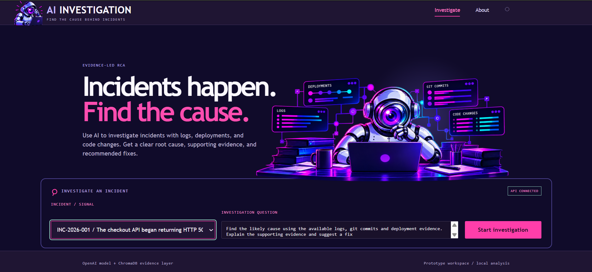
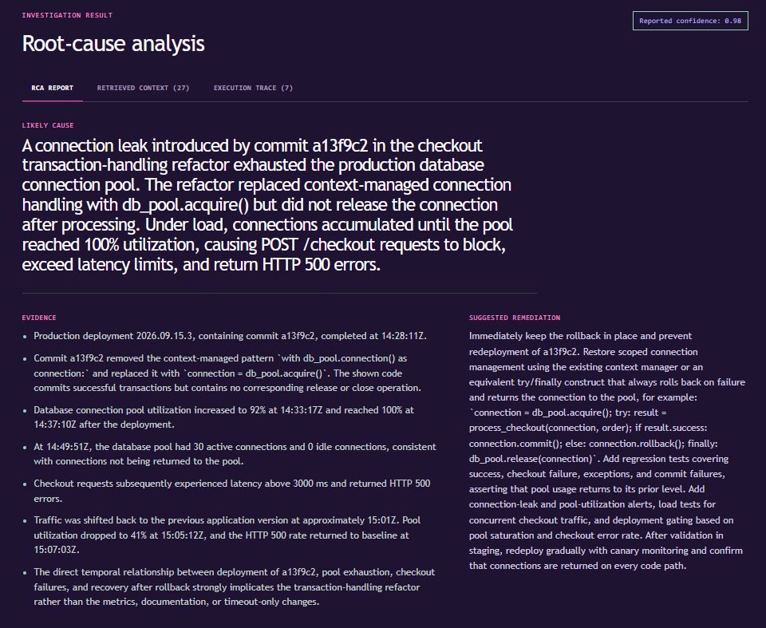
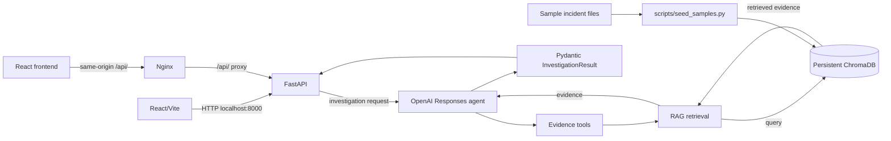

# AI Incident Investigator

[](https://github.com/wadoodali/auto-rca-agent/actions/workflows/ci.yml)



AI Incident Investigator is a portfolio prototype that uses a tool-using OpenAI agent and ChromaDB-backed retrieval to turn incident evidence into a structured root-cause analysis report.

It is designed to make incident investigation traceable: the agent searches logs, Git commits, and deployment evidence, then returns a validated report with supporting context and an execution trace. It is an engineering project for evaluation and demonstration, not a production-proven commercial system.

## Key capabilities

- RAG over incident logs, Git commit records, and deployment records stored in ChromaDB.
- OpenAI Responses API agent with explicit tool schemas and guarded tool execution.
- Incident-scoped retrieval with source-type filters for logs, commits, and deployments.
- Pydantic-validated RCA reports containing a likely cause, evidence, model-reported confidence, and suggested remediation.
- FastAPI endpoints and a React/Vite interface with Investigate and About routes.
- Deterministic report checks, optional provider-backed semantic evaluation, and unit tests for API, agent, tools, validation, and retrieval behavior.
- Docker Compose deployment with a seeded persistent ChromaDB volume, Nginx frontend proxying, GHCR image workflows, and a manual smoke test for published images.

## Example investigation



The report view presents the model-reported likely cause, supporting evidence, confidence, and suggested remediation. Confidence is constrained by the report schema to a value from 0.0 to 1.0, but it is model-reported and should not be interpreted as a calibrated probability.

## Architecture



The main implementation areas are:

- [`src/api/`](src/api/) validates requests and exposes the incident and investigation endpoints.
- [`src/agent/`](src/agent/) manages the Responses API loop, tool calls, duplicate-call protection, and execution traces.
- [`src/tools/`](src/tools/) defines and executes log, Git commit, and deployment evidence tools.
- [`src/rag/`](src/rag/) ingests documents, persists the ChromaDB collection, and applies retrieval filters.
- [`src/schemas/`](src/schemas/) defines the structured incident report and complete investigation result.
- [`frontend/src/`](frontend/src/) contains the React interface and API client.

## Technology stack

| Area | Technologies |
| --- | --- |
| Backend | Python 3.14, FastAPI, Uvicorn, Pydantic |
| Agent and providers | OpenAI Responses API, OpenAI embeddings, DeepEval, independent Groq judge for semantic evaluation |
| Retrieval | ChromaDB, persistent local collection, metadata-filtered search |
| Frontend | React, Vite, JavaScript, native CSS |
| Deployment | Docker, Docker Compose, Nginx, GitHub Actions, GitHub Container Registry |
| Quality checks | pytest, deterministic evaluation, semantic evaluation, container smoke testing |

## Evaluation and engineering quality

Run the offline unit suite from the repository root:

```powershell
python scripts/run_evaluation.py unit
```

Run the deterministic evaluation:

```powershell
python scripts/run_evaluation.py deterministic
```

Run both fast suites together:

```powershell
python scripts/run_evaluation.py all
```

The unit suite covers API validation and error boundaries, provider-error sanitization, tool execution, agent trace behavior, report schemas, retrieval filtering, and vector-store response validation. The deterministic suite checks incident-specific report properties such as confidence thresholds and introducing commits.

Semantic evaluation is intentionally separate and requires both `OPENAI_API_KEY` and `GROQ_API_KEY`:

```powershell
python -m pytest tests/evaluation/semantic -q
```

It uses external OpenAI and Groq-backed services and may incur API costs. Seed ChromaDB first when running it. The semantic evaluation workflow is manually triggered; it is not part of every push.

The GitHub Actions workflows provide these gates:

- `ci.yml` runs unit tests on pushes and pull requests targeting `master`; deterministic evaluation runs after unit tests, and the frontend runs `npm ci` plus `npm run build` in its own job.
- `semantic-evaluation.yml` runs provider-backed semantic checks only through `workflow_dispatch` and validates its API credentials first.
- `docker.yml` validates Compose configuration and builds backend/frontend images on pull requests and pushes. GHCR publication is limited to pushes to `master` and version tags beginning with `v`.
- `docker-smoke-test.yml` is manually triggered and checks the published commit-specific images through frontend delivery, SPA routing, FastAPI documentation, API routing, and the six sample incident IDs. The workflow files describe these checks; a local checkout does not prove that a particular remote run succeeded.

## Quick start: local development

Run commands from the repository root. Relative paths for `samples/` and the default ChromaDB location depend on that working directory.

### Prerequisites

- Python 3.14
- Node.js 22 and npm
- The pinned Python dependencies in `requirements.txt`

Create and activate a virtual environment in PowerShell:

```powershell
python -m venv .venv
.\.venv\Scripts\Activate.ps1
python -m pip install -r requirements.txt
```

Create a root `.env` file with at least:

```dotenv
OPENAI_API_KEY=your-openai-api-key
```

Optional settings include `OPENAI_MODEL`, `OPENAI_EMBEDDING_MODEL`, and `CHROMA_PATH`. `GROQ_API_KEY` is only needed for semantic evaluation. Never commit real credentials.

### Seed evidence and run the web application

Seed the six sample incidents and initialize the persistent `incident_evidence` collection:

```powershell
python scripts/seed_samples.py
```

Seeding uses OpenAI embeddings and may incur API costs. In one terminal, start FastAPI from the repository root:

```powershell
python -m uvicorn src.api.app:app --reload
```

In a second terminal:

```powershell
cd frontend
npm ci
npm run dev
```

Open the frontend at <http://localhost:5173>. FastAPI documentation is at <http://localhost:8000/docs>. Investigations use external OpenAI services and may incur API costs.

## Quick start: Docker Compose

Docker and Docker Compose are required for the containerized deployment. Configure the root `.env` with `OPENAI_API_KEY`; it is used for seeding embeddings and investigations.

From the repository root:

```powershell
docker compose up --build
```

Open the frontend at <http://localhost:8080>. FastAPI documentation is proxied at <http://localhost:8080/docs>; the backend port is internal to the Compose network.

ChromaDB persists in the named `chroma_data` volume mounted at `/app/data/chroma`. Stop and restart without deleting the evidence volume:

```powershell
docker compose down
docker compose up
```

Rebuild after deployment changes with `docker compose build` or `docker compose up --build`. The `chroma_seed` service runs the existing upsert-based seed operation before the backend. Re-running it updates matching IDs but does not remove stale records when source documents are deleted or reorganized. `docker compose down -v` deletes the named volume and requires reseeding; use it only when that reset is intentional.

## Repository structure

```text
.
├── src/
│   ├── api/                    # FastAPI routes and request models
│   ├── agent/                  # OpenAI investigation loop and traces
│   ├── rag/                    # Ingestion, ChromaDB, and retrieval
│   ├── schemas/                # Pydantic incident-report models
│   └── tools/                  # Tool definitions, execution, and evidence tools
├── frontend/
│   ├── src/                    # React application and API client
│   ├── Dockerfile.frontend     # Node build stage and Nginx runtime image
│   └── nginx.conf              # SPA fallback and backend proxy
├── samples/                    # Six sample incident evidence sets
├── scripts/
│   ├── seed_samples.py         # ChromaDB sample seeding
│   └── run_evaluation.py       # Unit/deterministic/semantic dispatcher
├── tests/
│   ├── unit/
│   └── evaluation/
├── Dockerfile.backend
├── compose.yaml
└── requirements.txt
```

## Limitations and future improvements

Current limitations:

- Investigations and embedding generation depend on external OpenAI services, credentials, network access, and API budget.
- Model-reported confidence is not calibrated uncertainty.
- The current seed operation uses `upsert()` and does not reconcile records removed from the source samples.
- Semantic evaluation depends on external providers and is manual rather than part of normal CI.
- There is no hosted demo; run the application through local development or Docker Compose. GitHub Actions builds and publishes the images and smoke-tests published images, but does not host a persistent running application.

Possible future improvements:

- Add explicit readiness and health endpoints for deployment orchestration.
- Add a documented rebuild/reconciliation path for stale ChromaDB records.
- Add provider-independent or recorded evaluation fixtures for lower-cost regression checks.

These are proposed improvements, not capabilities currently implemented by the repository.

## Explore the project

Browse the source and workflows on [GitHub](https://github.com/wadoodali/auto-rca-agent). The README, evaluation suites, container definitions, and CI workflows are intended to make the engineering decisions easy to inspect.
